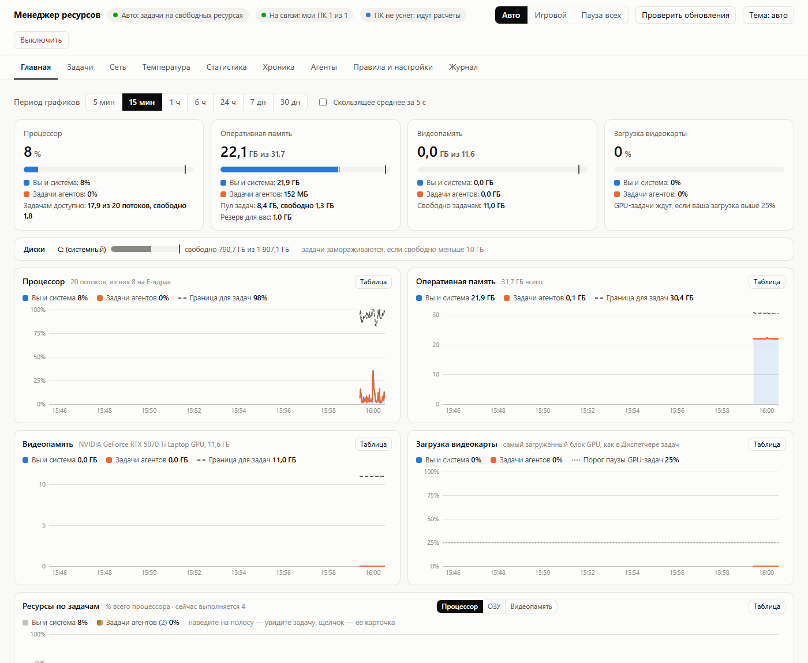

# RMQ — менеджер ресурсов ПК для ИИ-агентов

[](https://github.com/Hardos220/rmq/releases/latest)
[](LICENSE)


**English:** [README.en.md](README.en.md). Интерфейс и руководство для агентов — на русском.

Очередь для тяжёлых вычислений ИИ-агентов (Claude Code, Codex, Gemini CLI, Cursor и других), которая работает
**только на свободных ресурсах**. Игры, браузер, Steam и всё, что вы запускаете сами, работают как обычно: менеджер
их не трогает, а задачи агентов уступают им процессор, память, диск и видеокарту.

Зачем: агенты всё чаще сами запускают обучение моделей, симуляции, перебор параметров и сборки. Без очереди они
забирают весь ПК, мешают друг другу и вам, а ноутбук перегревается. С RMQ агент ставит задачу командой `rmq`, а
менеджер запускает её, когда для неё есть место, ужимает или замораживает, когда ресурсы нужны вам, и следит за
температурой.



- Дашборд в браузере: графики CPU / ОЗУ / VRAM / загрузки GPU, разделённые на «вы и система» и «задачи агентов»,
  и график «Ресурсы по задачам»: сколько процессора, памяти и видеопамяти берёт каждая задача в каждый момент.
- Очередь с приоритетами и честным делением ресурсов между агентами.
- Агенты сами узнают о системе из своих глобальных инструкций и регистрируются автоматически — ключи не нужны.
- Задачи переживают выключение и перезапуск менеджера.
- Бережёт железо: регулятор температуры плавно урезает задачам процессор, перегрев замораживает всё до остывания,
  а нехватка места на диске останавливает задачи раньше, чем начнёт сбоить Windows.
- Статистика нагрузки, температур и износа на вкладке «Статистика»; всё сохраняется в CSV-файлы в `data\stats`.
- «Хроника»: лента жизни каждой задачи, сравнение заявок с реальностью и карта часов, когда ПК считает.
- Вычислительная сеть: несколько ПК с менеджером объединяются через Tailscale, агенты отправляют задачи туда, где
  свободно. Свой ПК можно в любой момент закрыть для других или уйти в офлайн.
- Прогноз очереди: когда задача примерно стартует и закончится — по прошлым запускам той же команды.
- Занятная статистика: сколько энергии ушло на задачи, в кВт·ч и рублях.
- Обновляется сам из релизов на GitHub.

## Быстрый старт

**Нужно:** Windows 10 или 11 (64-бит) и [Python 3.10+](https://www.python.org/downloads/) — при установке Python
отметьте «Add python.exe to PATH». Права администратора не нужны.

1. Скачайте `rmq-<версия>.zip` со страницы [Releases](https://github.com/Hardos220/rmq/releases/latest), распакуйте
   его в `C:\` и переименуйте получившуюся папку `rmq-<версия>` в `RMQ`. Подойдёт и любая другая постоянная папка
   (не «Загрузки» и не временная: менеджер работает оттуда); ниже в примерах — `C:\RMQ`.
2. Запустите `install.cmd`. Если Windows предупредит, что файл скачан из интернета, подтвердите запуск. Установщик
   подготовит окружение Python, создаст ярлык, добавит правила для агентов, запустит менеджер и откроет дашборд
   http://127.0.0.1:8777.
3. Попросите агента в любом проекте сделать что-то тяжёлое: он прочитает правила и сам поставит задачу через `rmq`.
   Проверить вручную можно так:

   ```bat
   C:\RMQ\bin\rmq.cmd run --cpu 1 --ram 0.5 --time 1m -- python -c "print('привет из очереди')"
   ```

**Что установщик меняет на ПК** — только это:

- папку `.venv` с Python-окружением (внутри папки менеджера; ставится один пакет — psutil);
- ярлык «Менеджер ресурсов» на рабочем столе;
- блок правил между метками `<!-- rmq:begin … -->` и `<!-- rmq:end -->` в глобальных инструкциях тех агентов, что
  уже установлены: `%USERPROFILE%\.claude\CLAUDE.md` (Claude Code), `.codex\AGENTS.md` (Codex CLI),
  `.gemini\GEMINI.md` (Gemini CLI), `.codeium\windsurf\memories\global_rules.md` (Windsurf). Ваш текст в этих файлах
  не трогается. Для Cursor правила копируются вручную (вкладка «Агенты»).

Служб, драйверов, автозапуска и правок реестра нет. Настройки, база задач, логи и статистика живут в папке `data`
внутри папки менеджера.

**Дальше по желанию:**

- датчик температуры процессора — [tools/README.md](tools/README.md) (один запрос прав администратора);
- автозапуск при входе в Windows — Win+R → `shell:startup` → скопировать туда ярлык «Менеджер ресурсов»;
- несколько ПК в одной вычислительной сети — раздел [«Вычислительная сеть»](#вычислительная-сеть-несколько-пк).

## Удаление

1. В дашборде: «Выключить» → «Отменить задачи».
2. Убрать правила из инструкций агентов: `C:\RMQ\bin\rmq.cmd uninstall-agents`.
3. Если ставили датчик температуры процессора — `tools\uninstall_cpu_sensors.ps1` от имени администратора
   (см. [tools/README.md](tools/README.md)).
4. Если нажимали «Разрешить в брандмауэре» — удалите правило «RMQ resource manager (network)»: «Брандмауэр Защитника
   Windows» → «Дополнительные параметры» → «Правила для входящих подключений».
5. Удалите ярлык, папку менеджера и папку `%USERPROFILE%\AppData\LocalLow\RMQ` (она есть, только если на ваш ПК
   приходили задачи из сети).

## Безопасность и приватность

- **Без прав администратора и без вмешательства в систему.** Нет служб, драйверов, правок реестра, системных
  настроек и файла подкачки.
- **Только свои процессы.** Менеджер управляет лишь процессами, которые запустил сам: каждая задача сидит в своём
  Job Object — стандартном механизме Windows, которым пользуются Chrome и Docker. Задачам ставятся самые низкие
  приоритеты CPU, памяти и диска; приоритет диска выставляется тем же вызовом, что использует Process Lasso.
  Про остальные процессы менеджер только читает счётчики, как Диспетчер задач.
- **Только локальный доступ.** Дашборд и API слушают `127.0.0.1`. Агенты не получают вашего токена: настройки,
  режимы, чужие задачи и выключение доступны только дашборду. Веб-страницы в браузере достучаться до API не могут.
  Если вы включите вычислительную сеть, менеджер дополнительно слушает адрес Tailscale этого ПК, и только запросы,
  подписанные ключом сети (см. «Вычислительная сеть»).
- **Всё внутри папки проекта** (плюс ярлык, блок правил для агентов и папка `%USERPROFILE%\AppData\LocalLow\RMQ`
  для задач из сети). Окружение `.venv` с psutil тоже лежит здесь; как удалить всё — в разделе «Удаление».
- **В интернет — только за обновлениями.** Менеджер обращается к GitHub (`api.github.com`, `github.com`), чтобы
  проверить и скачать новый релиз; это выключается в «Правилах» (раздел «Обновления»). Телеметрии нет. Вычислительная
  сеть, если вы её включите, работает только через Tailscale между вашими ПК и ПК тех, кого вы пригласили.
- **Сообщить об уязвимости** — см. [SECURITY.md](SECURITY.md).

## Запуск и выключение

| Что | Как |
|---|---|
| Запустить и открыть дашборд | ярлык **«Менеджер ресурсов»** на рабочем столе: запускает менеджер в фоне, если он не запущен, и открывает http://127.0.0.1:8777 |
| Выключить | кнопка **«Выключить»** в дашборде: заморозить задачи (продолжат при следующем запуске), оставить их работать или отменить |
| Запустить с окном логов | `start.cmd` |
| Выключить без дашборда | `stop.cmd` (задачи замораживаются) |
| Автозапуск при входе (по желанию) | Win+R → `shell:startup` → скопировать туда ярлык «Менеджер ресурсов» |
| Пересоздать ярлык | `bin\rmq.cmd install-shortcut` |

Агенты могут сами поднять менеджер командой `rmq start`, если он не запущен.

## Агенты

**Регистрация.** Ключи не нужны. Команда `rmq` сама определяет, кто её вызвал: инструмент (`claude-code`, `cursor`,
`codex`, `vscode`…) и проект (корень git-репозитория или папка проекта). Агент получает имя вида
`claude-code@my-project` и регистрируется при первом обращении. На вкладке «Агенты» можно задать агенту вес, лимиты и
максимальный приоритет или отключить его. Агентам по умолчанию доступны приоритеты «низкий» и «обычный»;
«высокий» — только вашим задачам из дашборда.

**Как агенты узнают о системе:**

- **Claude Code, Codex, Gemini CLI, Windsurf.** Короткий блок правил добавляется в их глобальные инструкции
  (для Claude Code — `%USERPROFILE%\.claude\CLAUDE.md`). Блок стоит между метками; добавить или обновить его —
  `bin\rmq.cmd install-agents`, убрать — `bin\rmq.cmd uninstall-agents`.
- **Cursor.** Глобальные правила хранятся в его настройках, поэтому скопируйте текст с вкладки «Агенты» в
  Cursor Settings → Rules → User Rules.
- **Подробное руководство** ([AGENTS.md](AGENTS.md)) агент читает командой `rmq guide`. В нём описано:
  - когда использовать очередь;
  - как оценить CPU, ОЗУ, VRAM и время;
  - как ждать при таймаутах инструментов;
  - чекпоинты, GPU, разбор ошибок, HTTP API.

  Короткий блок обязывает прочитать руководство перед первым тяжёлым запуском. Так оно не раздувает контекст
  каждой сессии, в том числе тех, где вычислений нет.

## Как ставятся задачи

```bat
rmq run --cpu 4 --ram 8 --time 10m -- python analyze.py
rmq submit --cpu 8 --ram 16 --vram 6 --time 3h --preempt requeue --name train -- python train.py
rmq wait 12 --timeout 540     :: код выхода = код задачи, 124 = ещё работает
rmq logs 12 --tail 50
rmq status 12
rmq top
```

Прогресс задачи (процент, «сделано/всего» и оценка оставшегося времени) виден в дашборде и в `rmq status`. Менеджер
сам читает прогресс-бары `tqdm` из лога. Задача может сообщать прогресс и явно: записать в файл из переменной
`RMQ_PROGRESS_FILE` строку вида `37/120 эпоха 3` или `45%`.

Если задача 30 минут не подаёт признаков жизни (не грузит процессор и видеокарту, не пишет в лог и на диск, прогресс
не меняется), она замораживается с пометкой «Зависла» и сама не продолжит. Продолжить её можно кнопкой «Продолжить»
(агенту — `rmq resume <id>`), отменить — «Отменить».

`rmq` — это `bin\rmq.cmd` (cmd/PowerShell) или `bin/rmq` (Git Bash). Свои задачи удобнее ставить из дашборда
(вкладка «Задачи»).

## Правила

Все числа — значения по умолчанию: общие, подходящие большинству ПК. Меняются в дашборде на вкладке «Правила и
настройки». Там сверху — готовые режимы работы:

| Режим | Что задаёт |
|---|---|
| **Стандартный** (по умолчанию) | задачам — всё свободное, обычные цели температуры |
| **Бережный к железу** | цели температуры ниже (процессор 70°, плата 65°, видеокарта 75°, SSD 55°): меньше нагрев и износ |
| **Тихий** | пока вы работаете за ПК: задачам примерно 60% свободного процессора, больше запаса памяти, цели чуть ниже |
| **Максимум расчётов** | задачам — почти всё свободное; ваши программы всё равно первые |

Режим меняет только резерв для вас, температуру и порог загрузки видеокарты. Ниже — основные настройки, а под ними
раскрываются все остальные.

1. **Вы всегда первые.** Задачи работают с самым низким приоритетом процессора (Idle), диска и памяти.
2. **Пул для задач** — всё, что не заняли Windows и ваши программы, минус резерв: 5% свободного, но не меньше
   1 потока CPU, 1 ГБ ОЗУ и 0,5 ГБ VRAM. Пример: 32 − 8 (Windows) = 24 ГБ, задачам ≈ 22,8. Запустили игру на 10 ГБ:
   32 − 8 − 10 − 1 = 13 ГБ. Резерв CPU нужен не ради ваших программ (их и так пропускает Idle), а чтобы у системы был
   запас и ноутбук не грелся до упора.
3. **Вам понадобилась память.** Если свободной ОЗУ меньше резерва, задачи сразу замораживаются, а их память уходит в
   файл подкачки; задачи с `--preempt requeue` перезапускаются позже (см. «Мягкую остановку»). Первыми
   останавливаются задачи, превысившие заявку. Если игре нужно всё, останавливаются все. Память возвращается задачам,
   когда ваша нагрузка 60 секунд остаётся ниже.
4. **Процессор делится, а не захватывается.** Когда ПК простаивает, один агент может взять весь пул: всё, кроме вашей
   средней нагрузки за 10 секунд и резерва 5%. Заявка больше свободного (например, на все потоки ПК) означает «дай
   всё свободное». Новой задаче не нужно ждать, пока освободится процессор: работающие задачи ужимаются, в сумме не
   больше чем на 25%. Например, задача на весь процессор уступит 4 потока GPU-задаче, которой нужно немного процессора. Другой агент
   вправе получить свою долю целиком. Процессор делится поровну между агентами (кому нужно меньше — получает своё,
   остальное другим), никого не замораживая. Высокий приоритет получает CPU первым, низкий — только остатки;
   незанятое никогда не простаивает. Замораживают только из-за памяти.
5. **Игры** определяются по папке (Steam, Epic, GOG, Xbox, Riot, Ubisoft, EA) или по полноэкранному Direct3D. На время
   игры:
   - GPU-задачи на паузе;
   - CPU-задачи работают только на энергоэффективных E-ядрах (Intel 12-го поколения и новее; на процессорах без
     E-ядер — на половине потоков);
   - у задач включается EcoQoS, чтобы меньше грелся ноутбук;
   - **память освобождается заранее**: менеджер запоминает, сколько ОЗУ и видеопамяти заняла каждая игра, и при её
     следующем запуске сразу освобождает столько же. Для незнакомой игры — 2 ГБ.

   Если ваша загрузка видеокарты выше 25%, GPU-задачи ждут и без игры.
6. **Видеопамять.** Заморозка останавливает работу GPU-задачи, но видеопамять может остаться занятой. Если вашей
   программе её всё ещё не хватает, такая задача останавливается и перезапускается позже. Поэтому агентов учат
   сохранять чекпоинты.
7. **Заявка.** Задача заявляет ядра, ОЗУ, VRAM и ожидаемое время и стартует, только если заявка помещается в
   свободную часть пула.
   - **CPU** жёстко ограничен долей пула.
   - **GPU:** задаче без заявки VRAM видеокарта не видна (`CUDA_VISIBLE_DEVICES=""`).
   - **ОЗУ ограничено мягко:** перерасход виден в дашборде, такие задачи при нехватке останавливаются первыми, а при
     перезапуске ждут свой реальный пик. Жёсткий лимит памяти не ставится сознательно: он ронял бы задачи с
     нестандартным расходом памяти, а вас защищает заморозка.
8. **Порядок очереди — по очкам:**
   `1000 × приоритет (0 / 0,5 / 1) + 500 × честная доля агента + 300 × ожидание (до 1 за 4 ч) +
   150 × короткость (1 для ≤ 5 мин, 0 для ≥ 24 ч) + 100 уже начатым − 500 сверхурочным`.
   Честная доля = 2^(−доля агента в недавнем потреблении / доля его веса); потребление затухает вдвое за 12 ч.
   Очки есть и у выполняющихся задач, и у замороженных (они возобновляются в порядке очков). Но выполняющуюся задачу
   не вытесняют только за то, что у задачи из очереди стало больше очков (см. п. 10): в дашборде рядом с её очками
   написано, защищена ли она сейчас или может уступить место.
9. **Честное деление памяти.** Каждому агенту с задачами положена доля пула по весу (поровну), по самому занятому
   ресурсу, с допуском 5 процентных пунктов. Пока другой агент ждёт, агент сверх доли не может занимать нужную ему
   память.
10. **Никто не держит всё сутками.** Задачу агента сверх доли или задачу, работающую дольше заявленного, могут
   заморозить (не убить) в пользу задачи, которая ждёт дольше 2 минут (короткая, до 30 мин) или 10 минут (остальные).
   Защиты:
   - первые 20 минут после запуска или возобновления задачу не трогают;
   - высокий приоритет защищает только задачу, которая укладывается в заявленное время.
11. **Большие задачи не голодают.** Если первая в очереди задача ждёт дольше 20 минут, вперёд неё пускаются только
    задачи, которые успеют закончиться раньше. Если она ждёт дольше часа, она может вытеснять «захватчиков», даже
    если её агент при этом превысит свою долю.
12. **Время** считается только пока задача реально работает. Сверхурочная задача (заявка +10%) теряет очки и защиту,
    а её ресурсы засчитываются агенту вдвойне. `--time-limit` убивает задачу.
13. **Лимиты агента:** 4 задачи одновременно, 100 в очереди.
14. **Температура.** Менеджер следит за процессором, платой, видеокартой и SSD. Всё работает локально, без
    интернета. Источники:
    - процессор — LibreHardwareMonitor через подписанный драйвер PawnIO (см. [tools/README.md](tools/README.md)).
      Подойдёт и свой LibreHardwareMonitor из любой папки: в нём нужно включить Options → Remote Web Server → Run
      (порт 8085), а для запуска вместе с Windows — Options → Run On Windows Startup. Оттуда же менеджер берёт
      мощность процессора и частоты P- и E-ядер: они на вкладке «Температура», в статистике и в условиях счёта
      задач. Мощность объясняет температуру лучше нагрузки: ноутбук в режиме 45 Вт и в режиме 100 Вт греется
      и считает по-разному. На той же вкладке точечный график «мощность → температура» (у такого ноутбука это два
      облака) и строка о питании: от сети или от батареи, режим питания Windows и схема (режимы производителя
      ноутбука, например по Fn+Q, Windows не показывает);
    - плата — термозона ACPI (зоны-«пустышки» с невозможной температурой, которые бывают на настольных ПК,
      не учитываются);
    - видеокарта — драйвер NVIDIA: температура, а ещё мощность и частота — на тех же графиках, что у процессора
      (пока видеокарта спит, её не опрашивают, чтобы не будить);
    - SSD — сам диск.

    Правило:
    - **Регулятор** держит каждый компонент не выше его цели. По умолчанию цели общие и подходят большинству ПК:
      процессор 85°, плата 75°, видеокарта 83°, SSD 65°. Чтобы продлить жизнь железу, снизьте их в настройках,
      например до 70°/65°/75°/55°: задачи будут считать медленнее, зато ПК меньше греется.
      Пока компонент выше цели и не остывает, доля процессора для задач плавно снижается, но не ниже 20%; из-за
      видеокарты и SSD — не ниже половины, их греет в основном своя работа. Когда компонент остыл на 2° ниже цели,
      процессор так же плавно возвращается. Вместо резких скачков «полная нагрузка — заморозка — остывание»
      температура держится ровно: это бережнее к железу.
    - **Перегрев** (процессор ≥ 97°, плата ≥ 85°, видеокарта ≥ 90°, SSD ≥ 75°, но не выше порога, который сообщает
      сам диск, − 3°, а также торможение процессора или видеокарты из-за нагрева, о котором сообщает сам ПК) дольше
      10 секунд: **задачи агентов замораживаются**. Ваши программы и игры менеджер не ограничивает ни при каком
      перегреве: он управляет только процессами задач. Они продолжатся, когда всё остынет до нормы (процессор ≤ 75°, плата ≤ 70°, видеокарта ≤ 65°,
      SSD ≤ 50°) и пробудет там 2 минуты; сначала на половине процессора, остальное вернётся постепенно. Для
      видеокарты порог перегрева лучше ставить на 2° ниже её паспортного максимума.
    - Замороженные из-за нагрева задачи ничего не пишут на диск: их память выгружается, только если она понадобится
      вам.
    - Видеокарту менеджер спрашивает о температуре, только когда она и так работает, чтобы не будить спящую
      видеокарту ноутбука.
    - Графики температур и доли процессора от регулятора — на вкладке «Температура», цели и пороги — в настройках.
15. **Место на диске.** Если на системном диске свободно меньше 10 ГБ, все задачи замораживаются: Windows тоже нужно
    место для обновлений, файла подкачки и временных файлов. Если мало места на другом диске, замораживаются только
    задачи, которые работают в папке на нём. Свободное место видно на «Главной». Задачи продолжат сами, когда
    свободного станет на 2 ГБ больше.
16. **Мягкая остановка.** Если задачу с `--preempt requeue` нужно остановить не срочно (честная очередь или нехватка
    памяти, ещё не критическая), менеджер создаёт для неё файл `RMQ_STOP_FILE` и даёт 60 секунд, чтобы сохранить
    чекпоинт и завершиться. Не успела — задачу останавливают принудительно, как раньше. Когда память или видеопамять
    нужны вам срочно, задача останавливается сразу. Агентов учат проверять этот файл.
17. **Сон.** Пока выполняется хотя бы одна задача, Windows не уходит в сон по таймеру (экран гаснет как обычно).
    Используется штатный запрос «системе нужна работа», как у видеоплееров: настройки электропитания не меняются,
    запрос снимается, как только задач нет, и виден в `powercfg /requests` (консоль администратора). На батарее сон
    по умолчанию разрешён, чтобы расчёты не разрядили её (меняется в настройках). Время сна задачам не засчитывается.
18. **Вы управляете всем:** режимы «Авто» / «Игровой» / «Пауза всех», пауза, отмена и приоритет любой задачи,
    выключение.

## Вычислительная сеть (несколько ПК)

Несколько ПК с этим менеджером можно объединить: ваши агенты смогут отправлять задачи на другие ПК. Соединение идёт
через [Tailscale](https://tailscale.com) — бесплатную зашифрованную частную сеть, которая работает через любой роутер
без проброса портов. Всё управление — на вкладке **«Сеть»** в дашборде. У неё три раздела:

- **Обзор** — этот ПК в сети, таблицы «Мои ПК» и «Сеть с друзьями», приглашения и задачи, ушедшие через сеть;
- **Внутренняя сеть · мои ПК** — список ваших ПК сбоку; у выбранного видно всё, что показывает его собственная главная
  страница: загрузка, графики (в том числе «Ресурсы по задачам»), выполняющиеся задачи, очередь, температуры и недавно
  завершённые задачи. Щелчок по задаче открывает её карточку с логом. Основной ПК отсюда же ставит его задачи на
  паузу, продолжает и отменяет, открывает его настройки и может сделать его основным;
- **Внешняя сеть · друзья** — ПК сети с друзьями: их железо, режим, свободные ресурсы и задачи между вами (ваши у них
  и их у вас). Очередь и графики чужого ПК не видны: его менеджер сообщает другим только это.

На **«Главной»** под задачами этого ПК отдельным списком идут задачи, которые прямо сейчас выполняются на других ваших
ПК (сведения приходят раз в 10 секунд). Задачи на паузе стоят в «Очереди» вместе с ждущими, в общем порядке очков.

Сетей две:

| | **Мои ПК** (внутренняя) | **Сеть с друзьями** (внешняя) |
|---|---|---|
| Кто в ней | ваши собственные ПК | ПК других людей и те ваши ПК, которые вы им показали |
| Ключ | свой, его знают только ваши ПК | общий для участников |
| Чужие задачи на ПК | как свои: обычный приоритет, полный вес, без ограничений | низкий приоритет, без права менять файлы |
| Управление | основной ПК меняет настройки остальных и решает, какие из них видны друзьям | каждый управляет только своими ПК |

**Режимы этого ПК** (переключаются одной кнопкой; касаются сети с друзьями):

| Режим | Ваши агенты на других ПК | Задачи друзей на этом ПК |
|---|---|---|
| **Открыт для друзей** | да | да, с низким приоритетом |
| **Только для себя** | да | нет: присланные задачи замораживаются и продолжат, когда вы снова откроете ПК |
| **Офлайн** | нет | нет: никаких соединений, ни «Моих ПК», ни сети с друзьями |

Без интернета менеджер просто работает офлайн, как раньше: очередь, правила и дашборд от сети не зависят.

### Мои ПК

1. **Tailscale на каждом своём ПК** — в одном и том же аккаунте: тогда ПК видят друг друга сразу, без настройки
   общего доступа.
2. **На главном ПК:** «Сеть» → «Мои ПК» → «Создать». Он станет основным.
3. **Добавить ПК:** на основном — «Добавить мой ПК» → «Получить код»; на другом своём ПК — «Присоединить этот ПК к моим
   ПК» → вставить код. Код даёт управление вашими ПК, не пересылайте его другим людям.
4. **Управление с основного ПК.** В таблице «Мои ПК»:
   - «Для друзей»: «Открыт для друзей», «Только пользуется» (его агенты считают на ПК друзей, а друзья у него — нет) или
     «Скрыт от друзей» (друзья его не видят вовсе);
   - «Подробнее» открывает ПК во «Внутренней сети»; там кнопка «Настройки этого ПК» ведёт на вкладку «Правила и
     настройки» этого ПК: режим работы и все настройки сохраняются на нём самом.
   - «Обновить все мои ПК» (на карточке основного ПК): каждый ПК сразу проверит обновления и поставит новую версию
     сам. Если версии на ваших ПК разные, над таблицей появится предупреждение: задачи и графики других ПК видны
     полностью, когда версии совпадают.
   Смотреть задачи и графики других своих ПК можно с любого из них, менять их настройки и управлять их задачами —
   только с основного. На вкладках «Статистика» и «Хроника» можно выбрать ПК: этот, другой из «Моих ПК» или все
   вместе (задача, отправленная с одного ПК на другой, показывается один раз — там, где выполнялась).
5. **Если основной ПК больше не работает**, на любом другом своём ПК нажмите «Сделать этот ПК основным».

`rmq submit --where auto` сначала ищет свободный из ваших ПК, а потом уже ПК друзей.

### Как подключить друга

1. **Tailscale у обоих.** Установите [Tailscale](https://tailscale.com/download) и войдите в него (подойдёт аккаунт
   Google, Microsoft или GitHub). Значок Tailscale в трее должен показывать «Connected».
2. **ПК видят друг друга в Tailscale.** Проще всего пригласить друга в свою сеть Tailscale:
   [login.tailscale.com/admin/users](https://login.tailscale.com/admin/users) → Invite users. Если у вас в Tailscale
   есть и другие устройства (телефон, NAS), безопаснее не приглашать друга целиком, а поделиться с ним только этим ПК
   (Machines → «⋯» → Share), а он поделится своим ПК с вами. Делиться нужно в обе стороны, иначе задачи пойдут только в
   одну.
3. **Менеджер у друга** — как в разделе [«Быстрый старт»](#быстрый-старт).
4. **Вы** (на основном ПК, если у вас несколько): вкладка «Сеть» → «Сеть с друзьями» → «Создать сеть с друзьями» →
   «Пригласить друга» → «Получить код». Скопируйте код `rmq1-…` и пришлите другу в мессенджере. В коде лежит ключ сети,
   поэтому отправляйте его только тому, кого приглашаете.
5. **Друг:** вкладка «Сеть» → «Присоединиться по коду друга» → вставить код. Через несколько секунд ПК увидят друг
   друга. Какие ещё ваши ПК видны другу, решает ваш основной ПК (столбец «Для друзей»).
6. **Брандмауэр Windows.** Когда менеджер начнёт принимать подключения, Windows спросит, разрешить ли Python доступ к
   сети. Нажмите «Разрешить доступ» на обоих ПК: иначе другой ПК не сможет до вас достучаться. Сеть Tailscale Windows
   считает частной, поэтому достаточно галочки «Частные сети».
7. **Понятные имена.** В поле «Имя этого ПК в сети» дайте ПК имя (например, «Иван»): по нему агенты отправляют туда
   задачи (`rmq submit --where Иван …`).

Та же инструкция есть на вкладке «Сеть».

Новых участников может приглашать любой участник. На вкладке видно, какие ПК в сети и на связи ли они, их железо,
режим, свободные ресурсы и версия менеджера. ПК, который сейчас выключен или без интернета, показывается «не в сети»
со временем, когда его видели последний раз. Кнопка «Выйти из сети с друзьями» отменяет ваши задачи на ПК друзей и их
задачи на вашем («Мои ПК» это не затрагивает), а остальные участники видят ваш ПК как «вышел из сети».

### Если связи нет

Если один ПК слышит другой, но не может до него достучаться, в таблице «Компьютеры сети» появится подсказка, на каком
ПК искать причину.

Когда до другого ПК не достучаться, менеджер раз в минуту сам выясняет причину. Он спрашивает Tailscale на этом ПК:
подключён ли тот ПК и работает ли туннель до него. Ещё он проверяет, не уводит ли VPN трафик мимо Tailscale.
Причина и что сделать видны у ПК на вкладке «Сеть», а коротко — в `rmq nodes`. Ничего не меняется само: менеджер
только подсказывает.

| Что видно | Что сделать |
|---|---|
| «Tailscale не найден» | установить Tailscale и войти в него; значок в трее должен показывать «Connected» |
| ПК друга «не в сети» | у друга выключен ПК, менеджер или Tailscale; в Tailscale (Machines) оба ПК должны быть видны и подключены |
| «Этот ПК не может связаться с ним» | на том ПК брандмауэр не пускает Python, или тот ПК не поделился с вами в Tailscale |
| «Он не может связаться с этим ПК» | то же, но у вас: разрешите Python в брандмауэре и проверьте общий доступ в Tailscale |
| Python в брандмауэре случайно запретили | Панель управления → Брандмауэр Защитника Windows → Разрешение взаимодействия с приложением → «Изменить параметры» → у Python (pythonw.exe) отметить «Частная» |
| «Tailscale видит тот ПК, но туннель между ПК не устанавливается» | переподключите Tailscale: сначала на том ПК, потом на этом (значок в трее → Disconnect → Connect) |
| «Трафик к тому ПК уходит в «…», а не в Tailscale» | в этом VPN исключите адреса 100.64.0.0/10 (раздельное туннелирование) или выключите его на время |
| Связь пропадает только при включённом VPN | VPN может мешать Tailscale: исключите Tailscale из VPN (адреса 100.64.0.0/10 и, если VPN умеет исключать программы, tailscaled.exe) или выключите VPN |
| «Часы расходятся больше чем на 5 минут» | включить «Установить время автоматически» (Параметры → Время и язык) |
| «Не удалось присоединиться» | скопировать код целиком; у пригласившего должен работать менеджер не в режиме «Офлайн», а ПК — быть виден в Tailscale |

### Как агенты пользуются сетью

`rmq nodes` показывает ПК сети и сколько у них свободно. `rmq submit --where auto …` ставит задачу туда, где она
стартует сразу (если такого ПК нет — здесь), `--where <имя ПК>` — на конкретный ПК. Без `--where` задача всегда
выполняется на этом ПК. Менеджер:

1. упаковывает папку проекта (файлы git-репозитория, а без git — папку без `.venv`, `.git`, `node_modules` и кэшей;
   не больше 1 ГБ) и отправляет её на выбранный ПК;
2. там ставит пакеты из `requirements.txt` в отдельное окружение Python (один раз, потом оно переиспользуется);
3. следит за задачей: статус, лог и прогресс видны здесь, `rmq wait`, `rmq logs` и `rmq cancel` работают как обычно;
4. когда задача закончится, забирает созданные и изменённые ею файлы обратно в папку проекта и просит хозяина
   удалить свою копию.

Сеть рассчитана на Windows-ПК и на задачи на Python или на программах, которые есть на обоих ПК.

### Что задача друга может на вашем ПК

- **Стоит в вашей очереди с низким приоритетом.** Ваши программы, ваши агенты и все ваши правила (игры, память,
  температура, диск) важнее. Агенты участников делят процессор с весом 0,5 от ваших, одновременно у вас не больше 8
  их задач.
- **Не может менять ваши файлы.** Задачи участников работают с пониженным уровнем доступа Windows (Low integrity, как
  вкладки браузера): читать файлы могут, а писать — только в свою папку в `%USERPROFILE%\AppData\LocalLow\RMQ`.
- **Не видит ваших секретов.** Ей доступны только системные переменные окружения и те, что передал её агент, но не
  ваши ключи и токены.
- **Ограничена по месту.** Файлы участников вместе занимают не больше 20 ГБ, незабранные результаты удаляются через
  72 часа.

Всё это меняется в «Правилах» (раздел «Вычислительная сеть»).

### Как это устроено

- Менеджер слушает сеть только на адресе Tailscale этого ПК (порт 8778): из интернета и из локальной сети его не
  видно. Дашборд и API для агентов по-прежнему доступны только с этого ПК.
- Каждый запрос между ПК подписан ключом своей сети (HMAC-SHA256 со временем и одноразовой меткой), неподписанные и
  повторённые запросы отклоняются. У «Моих ПК» ключ свой: участники сети с друзьями не могут ни управлять вашими ПК,
  ни обратиться к задачам, которые ваши ПК передают друг другу. Сам трафик шифрует Tailscale.
- Каждые 30 секунд ПК обмениваются состоянием: свободные ресурсы, режим, версия и список участников. Центрального
  сервера нет: сеть работает, пока на связи хотя бы два участника.

## Установка на другой ПК

Так же, как в разделе [«Быстрый старт»](#быстрый-старт); архив можно взять и у друга. Права администратора Windows
спросит только по желанию: для датчика температуры процессора и для разрешения в брандмауэре, если подключаете сеть.

Настройки по умолчанию общие и подходят большинству ПК и ноутбуков. Свои значения задаются в «Правилах»: в
`data\settings.json` хранится только то, что вы изменили, и обновления этого не трогают.

## Обновления

- **Установки из архива обновляются сами.** При каждом запуске и затем раз в 6 часов, если есть интернет, менеджер
  проверяет последний
  [релиз](https://github.com/Hardos220/rmq/releases) на GitHub. Новую версию он скачивает, сверяет её SHA-256, замораживает задачи, заменяет
  файлы программы (`data\` и `.venv\` не трогаются), перезапускается, и задачи продолжают с того же места. Состояние
  обновлений и кнопка «Проверить сейчас» — на вкладке «Сеть», выключить — в «Правилах».
- **Выпускать обновления может только владелец репозитория.** Менеджер скачивает только опубликованные им релизы,
  а рабочая копия разработчика (папка с `.git`) себя не обновляет. Что менялось в каждой версии —
  [CHANGELOG.md](CHANGELOG.md) и страница [Releases](https://github.com/Hardos220/rmq/releases).

## Прогноз очереди и скорость своих ПК

Менеджер раз в 15 секунд проигрывает очередь вперёд и пишет у задач, когда они примерно стартуют и закончатся
(«старт ~15:40 · конец ~16:30»): в очереди и карточке задачи, а агентам — в `rmq status` и `rmq queue`. Сколько задача
будет работать, он берёт из прошлых успешных запусков той же команды (числа в аргументах не в счёт), иначе — из её
заявки, а у работающей — из прогресса. Учитываются порядок очереди, память, лимиты агентов, серии и `--after`.
Это оценка: она считает, что вы пользуетесь ПК как сейчас, — игра, пауза или новые задачи её сдвигают.

Из тех же прошлых запусков видно, во сколько раз дольше одни и те же команды идут на другом вашем ПК: это написано у
ПК на вкладке «Сеть» и в `rmq nodes`. Задача с `--where auto` уходит на более медленный ПК, только если там она
закончится раньше, чем здесь после очереди. Пока одна и та же команда не выполнялась на обоих ПК, скорость не
известна, и выбор идёт как раньше: по свободному процессору.

На вкладке «Сеть» видно и то, как Tailscale соединяет ПК: напрямую или через свой сервер-ретранслятор (медленнее; так
бывает из-за VPN или роутера).

## Хроника

Вкладка **«Хроника»** показывает, как жили задачи за 24 часа, 7 дней или 30 дней:

- **Лента задач** — строка на задачу, свежие сверху: когда она ждала в очереди, работала и была заморожена (и почему — во
  всплывающей подсказке), где её перезапускали и чем она закончилась. Щелчок открывает карточку задачи.
- **Заявка и реальность** — сколько памяти или процессора задача заявила и сколько использовала на деле. Видно, кто
  из агентов заявляет с запасом, а кто не дотягивает.
- **Когда ПК считает** — карта по дням недели и часам: в какие часы обычно идут расчёты.
- Забавные факты: самая долгая задача, дольше всех ждавшая и «главный трудяга» среди агентов.

Хроника собирается из журнала событий, который хранится 12 месяцев (как и завершённые задачи с их логами).

## Статистика

На вкладке **«Статистика»** — отчёт за 24 часа, 7 дней, 30 дней или всё время:

- сколько шли расчёты и сколько процессора и видеокарты получили задачи;
- температуры: максимум, среднее во время расчётов, сколько времени компоненты были выше цели;
- сколько раз срабатывала заморозка из-за перегрева и из-за места на диске;
- сколько задачи записали на диск — это главный источник износа SSD;
- энергия задач — занятная оценка: мощность процессора и видеокарты делится между задачами по доле времени, которое
  они их занимали. В кВт·ч, в рублях по тарифу из «Правил и настроек» (по умолчанию 8,90 ₽ за кВт·ч) и «в чайниках»;
- то же по каждому агенту.

Всё сохраняется в папке `data\stats`, файлы можно скачать прямо со вкладки:

- `hourly.csv` — по часу на строку, хранится всегда;
- `agents_hourly.csv` — по агентам и часам;
- `minutes-ГГГГ-ММ.csv` — поминутно, хранится 12 месяцев;
- `tasks.csv` — по строке на каждую завершённую задачу (ожидание, время работы, заявка, сколько реально заняла,
  условия счёта), хранится всегда — сама задача с логом уходит из менеджера через 12 месяцев;
- `README.txt` — что означает каждая колонка.

Это обычный CSV (запятая, дробная часть через точку): в Excel — «Данные → Из текстового/CSV-файла». Час, который ещё
идёт, сохраняется каждую минуту, так что перезапуск или сбой теряют не больше минуты. Агенты читают ту же статистику
командами `rmq stats`, `rmq past` и `rmq history` (только чтение; описано в `rmq guide`).

## Что стоит знать

- **Заморозка выгружает память задачи на диск**, поэтому освобождение 10 ГБ занимает несколько секунд. Ради этого
  менеджер освобождает память игре заранее.
- **Файл подкачки.** Пока он заполнен больше чем на 90%, новые задачи не стартуют, а при 96% задачи перезапускаются
  позже — это защита от нехватки виртуальной памяти.
- **Крышка ноутбука.** Закрытие крышки, кнопка питания и «Пуск → Сон» усыпляют ПК как всегда — это ваше действие,
  менеджер ему не мешает. Задачи просто встанут и продолжат после пробуждения. Чтобы считать с закрытой крышкой,
  выберите в «Электропитании» действие при закрытии крышки «Ничего не делать» (это системная настройка, менеджер её
  не трогает).
- **Сеть не ограничивается.** Агентов просят не запускать через очередь сетевые сервисы.
- **Определение игр.** Если игра не распознана, добавьте её `.exe` в настройках или включите «Игровой» режим вручную.
  Если игровой режим включается ложно, причина видна в шапке дашборда — добавьте процесс в исключения.

## Частые вопросы

- **Linux или macOS?** Нет, только Windows 10 и 11: менеджер держится на механизмах Windows (Job Objects, счётчики
  производительности, приоритеты ввода-вывода).
- **Какая нужна видеокарта?** Любая или никакой. Загрузку и видеопамять Windows показывает для любой видеокарты, а
  температуру, мощность и частоту менеджер читает только у NVIDIA (через её драйвер).
- **Какие агенты подойдут?** Любые, которые умеют запускать команды в терминале. Правила ставятся сами для Claude Code,
  Codex CLI, Gemini CLI и Windsurf, для Cursor — вручную; остальным можно дать текст правил с вкладки «Агенты» или
  [AGENTS.md](AGENTS.md). Без терминала агент может работать через HTTP API (раздел 16 руководства).
- **Зачем Python?** Менеджер написан на Python и ставит себе отдельное окружение в своей папке: ваши проекты и их
  окружения он не трогает.
- **Агент запускает вычисления мимо очереди.** Проверьте, что правила установлены (вкладка «Агенты») и что агент
  перечитал инструкции (новая сессия). Правило мягкое: менеджер не может запретить агенту запускать программы
  напрямую.
- **Интерфейс по-английски?** Пока только русский.
- **Нашли ошибку или хотите предложить улучшение** — [Issues](https://github.com/Hardos220/rmq/issues), как
  участвовать в разработке — [CONTRIBUTING.md](CONTRIBUTING.md).

## Файлы

- `rmq/` — код менеджера (что где — в [CONTRIBUTING.md](CONTRIBUTING.md)), `rmq/static/` — дашборд.
- `AGENTS.md` — полное руководство для ИИ (`rmq guide`), `agent_rules.md` — короткий блок для глобальных инструкций.
- `bin/rmq.cmd`, `bin/rmq` — команда для cmd/PowerShell и Git Bash; `install.cmd` — установка.
- `tools/` — датчик температуры процессора (установщик и описание) и инструменты разработчика.
- `data/` — настройки, база, логи задач, статистика (`data/stats`), токен дашборда и ключ сети. Создаётся при
  первом запуске. Не выкладывайте её: в базе хранятся окружения задач, а в `network.json` — ключ сети.

## Лицензия

[Apache License 2.0](LICENSE) с обязательным указанием автора: распространяя программу или работы на её основе,
сохраняйте файл [NOTICE](NOTICE) и указывайте автора (Hardos220) и ссылку на https://github.com/Hardos220/rmq.
Сторонние компоненты из архива релиза и их лицензии — в [THIRD_PARTY.md](THIRD_PARTY.md).
